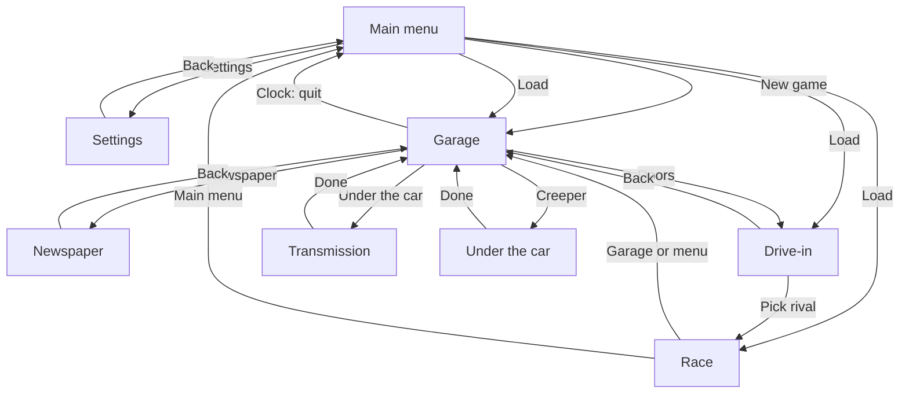
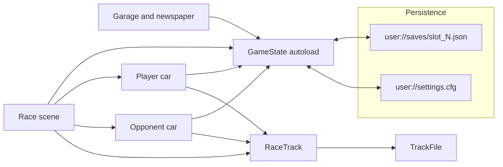
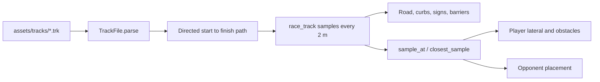

# Architecture

Street Rod 3 is a single-player Godot 4.6 game. The player builds a car in a garage, buys parts from a newspaper, then races one opponent on either a straight drag strip or a road course loaded from a `.trk` file.

There is no server, database, or external API. All state lives in the `GameState` autoload and is written to the local `user://` directory.

## Scene flow

`project.godot` starts at `res://scenes/main_menu.tscn`. Scenes swap with `SceneTree.change_scene_to_file`. `GameState` stores the last gameplay scene so Load can return there.



| Scene | Script | Role |
| --- | --- | --- |
| `scenes/main_menu.tscn` | `scripts/main_menu.gd` | New game, load (from the save slot list), settings, quit |
| `scenes/settings.tscn` | `scripts/settings.gd` | Fullscreen, master volume, music toggle |
| `scenes/garage.tscn` | `scripts/garage.gd` | Orbit camera, clickable props, paint, stats |
| `scenes/newspaper.tscn` | `scripts/newspaper.gd` | Buy parts, gearboxes, and used cars |
| `scenes/transmission.tscn` | `scripts/transmission.gd` | Under the car: bellhousing bolts, gearbox out and in on a jack |
| `scenes/under_car.tscn` | `scripts/under_car.gd` | On the creeper: exhaust manifolds, muffler, and rear end |
| `scenes/hood.tscn` | `scripts/hood.gd` | Under the hood: engine, intake, carburetors, distributor, air cleaner, plug wires |
| `scenes/tune.tscn` | `scripts/tune.gd` | Timing light on the balancer: advance or retard the distributor |
| `scenes/drive-in.tscn` | `scripts/drive-in.gd` | Drag vs road, then pick a rival |
| `scenes/race.tscn` | `scripts/race.gd` | Countdown, HUD, finish, results |
| `scenes/car_vehicle_visual.tscn` | `scripts/car_vehicle_visual.gd` | Shared body and wheel visuals, instanced by garage and both race cars |

## Modules



### Game state

`scripts/game_state.gd` is the only autoload (`GameState`). It owns:

- Economy and garage: cash, owned cars, parts, gearboxes, equipped gearbox and its bolt turns, paint color.
- Catalogs: `USED_CARS`, `PARTS`, `GEARBOXES`, `OPPONENTS` (static dictionaries, not resources).
- Race selection: `selected_race_type` (`drag` or `road`) and `selected_opponent_id`.
- Derived stats: `refresh_car_stats()` rebuilds base vmax and horsepower from the current car plus owned parts. `get_effective_vmax_kmh()` then scales by the equipped gearbox `top_speed`.
- Music: one `AudioStreamPlayer` on the autoload. Race uses `assets/music/race.mp3`; every other scene uses `assets/music/garage.mp3`.
- Save and settings (see [setup.md](setup.md)).

Scenes talk to each other only through `GameState` and scene changes. Race scripts duck-type neighbors with `has_method` (`is_race_started`, `get_race_track`, `sample_at`, `closest_sample`).

### Garage

`garage.gd` raycasts from the orbit camera. Colliders carry a `garage_interact` meta tag:

| Tag | Result |
| --- | --- |
| `clock` | Save or load through the save slot list (`save_slots.gd`), or return to the main menu |
| `chart` | Stats overlay |
| `newspaper` | Open the classifieds |
| `radio` | Toggle music |
| `doors` | Open the drive-in |
| `spray` | Color picker; writes `GameState.car_color` |
| `calendar` | Pulls the wall calendar toward the camera |
| `transmission` | Opens the transmission scene (low band between the wheels, or T) |
| `creeper` | Opens the under-car scene (the creeper on the floor, or U) |

### Transmission

`transmission.gd` shows the underside of the car on a lift: the equipped engine model at real scale, a gearbox built from primitives (iron with a pan for automatics, aluminum with a rib per gear for manuals, black and red for racing boxes), two bellhousing bolts, and a transmission jack. Bolt state lives on `GameState.gearbox_bolts` (0 out to `GEARBOX_BOLT_TIGHT`) and is saved per car.

- Clicking a bolt hole threads the bolt in. Each click tightens it a turn until it is tight. Clicking a tight bolt backs it out a turn at a time until it drops to the floor.
- With both bolts out, `GameState.remove_gearbox()` sets the gearbox to `NO_GEARBOX_ID` and it goes to spare parts. The jack takes it down after the crossmember is pulled.
- Select lists spare gearboxes. It refuses while a gearbox is still in. `fit_gearbox()` raises the chosen one in with both bolts at one turn.
- `GameState.can_drive()` needs an engine that runs (`engine_runs()`, see Under the hood) and both bolts tight. The garage doors use it.

Bought gearboxes go to spare parts (`buy_gearbox`). The spare-parts Fit button for a gearbox opens this scene instead of swapping it instantly.

### Under the hood

`hood.gd` looks down into the engine bay from in front of the car; the wheel zooms and right-drag orbits. The engine is built by `engine_assembly.gd` in layers, as in Street Rod 2, each a rig of its own: the engine on two mounts, the intake on the engine, one to three carburetors and the distributor in the intake, the air cleaner over the carburetors, and the plug wires from the cap to the plugs. Each engine uses its own `assets/parts/engine-v8-*.glb` (the 350 shares the 327's), split by node name: the long block is the model less its intake, carburetor, distributor, and front drive, and the cast-iron intake, the stock four-barrel carburetor, and the distributor are those nodes of the same model in rigs of their own. The front drive (balancer, timing tab, pulleys, belt, alternator), the other intakes, the two-barrel carburetor, the air cleaners, the cap's plug towers, and the wires are built from primitives in the models' frame: +X toward the back of the car with the block from -1.5 to 1.5, +Z up, the crank at Z -0.36.

The hood slots are `GameState.HOOD_SLOTS`: `intake`, `carb`, `carb_2`, `carb_3`, `distributor`, and `air_cleaner`, kept in `slot_part_ids` with the under-car slots and saved the same way. An intake's `carbs` and `barrels` say how many carburetors it takes and of what kind (`carb_slots()`, `carb_fits_intake()`); a carburetor has `cfm`, a distributor its cap color and `drift`. Every part is held by the bolts in `HOOD_BOLT_COUNTS`, turned like the bellhousing bolts and saved per car as `engine_bolts`; a part with no entry is tight, so older saves load bolted down. `plug_wires` is saved per car too.

- Bolt holes have click spheres on a physics layer of their own, and each part has a click box from its meshes' bounds. A bolt under the pointer wins over a part box unless the box's face is more than 10 cm in front of it, since a part's box takes in its own bolts. Clicking a bolt hole threads its bolt in, each click after that tightens it, and clicking a tight bolt backs it out into the tray on the fender. When all of a part's bolts are out and nothing is on top of it (`hood_part_blocker()`), it lifts off into spare parts (`remove_hood_part()`), and the parts under it follow if their bolts are out too. The air cleaner is on top of the carburetors, the carburetors and the distributor on the intake, and the intake on the engine; the plug wires have to come off before the distributor.
- Parts lists the spares for every empty spot (`hood_spot_trouble()` says why a spot cannot take one yet). `fit_engine()` and `fit_hood_part()` lower the part in with its bolts at one turn.
- `engine_runs()` needs the engine, intake, every carburetor the intake takes, and the distributor in and tight, and the plug wires on. `engine_trouble()` says what is wrong, for the hint and the garage doors' tooltip. The air cleaner is optional.
- Hood parts add `hp` and `vmax` like the under-car parts; each carburetor of a multi-carb intake adds its share. `carb_flow_factor()` takes power off when the carburetors' total `cfm` is well under what the engine's `cid` wants or far over it.
- A blown engine (`remove_engine()`) leaves what was bolted on top of it in spare parts. Spare engines and hood parts open this scene from the spare-parts Fit button. The old performance carburetor and intake bolt-ons are now hood parts, and saves that had them fitted get them moved into their slots.

### Timing

`tune.gd` is Street Rod 2's tune screen: the engine idles, a timing light flashes once every two crank turns, and each flash stops the balancer with its mark at the timing against the tab (`engine_assembly.gd`'s `mark_angle()`, the tab drawn wider than real so it can be read). `engine_tune` is the timing in steps of `TIMING_DEG_PER_STEP` degrees before top dead center (`timing_degrees()`); Advance and Retard step it. The tune-up sticker shows the engine's sweet spot, and as in Street Rod 2 there is a pointer to set the mark against: a lit red pointer on the tab at the sweet spot. The mark stays where the last flash caught it and glows for a moment after each flash. Away from the sweet spot the mark wanders from flash to flash, and the idle drops, while `engine_sound.gd`'s `set_tune()` adds a second firing beat that drifts against the first and misses a firing now and then, both more often the further off it is. This is after Street Rod 2's two engine notes that only agree in tune. The idle plays louder there and the music is all but muted. The distributor's `drift` scales how likely the timing is to move after a race. Tune is open only when the engine runs, and Done goes back under the hood.

### Under the car

`under_car.gd` looks up at the whole underside of the car on jack stands, front to the right of the screen and tilted a little across the car. It shows the equipped engine model and a driveline, exhaust, and axle built from primitives. The wheel zooms and right-drag tilts the view.

The slots are the exhaust manifolds, the exhaust, the muffler, a left muffler, and the rear end (`GameState.UNDER_CAR_SLOTS`). The left muffler is used only behind a dual exhaust (`active_slots()`, `muffler_slots()`); a single exhaust's one muffler is `SLOT_MUFFLER`, on the car's right. Parts in the register's `parts` list name the kind of slot they fit in `slot` (both muffler slots take `muffler` parts, `spot_kind()`), their look in `style`, and a dual exhaust has `dual`. The parts are drawn per style: log manifolds, shorty or long-tube headers, single or dual head pipes, oval, turbo, or glasspack mufflers each with its tailpipe, and iron, chrome, finned, or girdled rear-end covers with the ratio on a tag. Each car starts with the `stock` parts in `STOCK_SLOT_PARTS`. The active car's slots live on `GameState.slot_part_ids`, apart from the bolt-ons in `equipped_part_ids`, and are saved per car as `slot_parts`.

- Clicking a part, or pressing 1 to 5, lists the spares for that slot. `fit_slot_part(part_id, slot)` swaps one in, and the old part goes to spare parts. A muffler needs an exhaust to hang on.
- The exhaust and the mufflers can come off (`remove_slot_part()`, `REMOVABLE_SLOTS`); the slot then holds `NO_PART_ID`. With the exhaust off the headers are open, and the mufflers come off with it. With a muffler off its pipe ends where the muffler bolts on, with no tailpipe. Going from a dual to a single exhaust takes the left muffler off.
- An open header or open pipe is `OPEN_EXHAUST_DB` louder than stock, and a muffler's `loud_db` sets how much louder it is; the two sides of a dual exhaust are averaged (`exhaust_volume_db()`).
- Manifolds, the exhaust, and mufflers add `hp` and `vmax` like bolt-ons. Each muffler on a dual exhaust adds half. A rear end's `accel` scales the drive force in every gear (`final_drive_accel()`), and its `top_speed` scales `get_effective_vmax_kmh()`.
- Any number of copies of a part from the parts list can be bought, bolt-ons included, one for each car or each side of a dual exhaust (`part_count()`, `spare_count()`). Stock parts never run out. Fitting a part takes a copy off another car only when more copies are fitted than are owned.
- Bought slot parts go to spare parts. Their spare-parts Fit button opens this scene. Older saves that kept the headers as a bolt-on get them moved into the manifold slot, and saves from before the exhaust slot get a stock single exhaust.

The calendar page is built at runtime from the system date (`Label3D` grid).

### Race

`race.gd` runs a three-phase start light (red, red+orange, green). Cars stay stopped until green. The HUD shows speed, gear, distance, time, and opponent name. `rpm_meter.gd` draws the tachometer. `race_touch_controls.gd` shows a wheel, pedals, and shift paddles on mobile, web-mobile, or viewports 900 px wide or narrower.

Two layouts share `scenes/race.tscn`:

- **Drag** (`GameState.RACE_DRAG`): a straight quarter mile (402.336 m) along `+Z`. `track_visuals.gd` builds curbs and a checkered gantry. The ground plane stays active. Finish is an `Area3D`.
- **Road** (`GameState.RACE_ROAD`): `race_track.gd` hides the strip, loads `res://assets/tracks/track1.trk`, and builds the road mesh. The finish area is moved to the path end. Progress also ends the race when remaining distance is about 1 m, because the opponent is placed on the path rather than driven into the trigger.

A win is crossing the finish before the opponent. Holding a manual gearbox past critical RPM for 0.55 s blows the engine and ends the race.

### Cars

Both cars are `CharacterBody3D` nodes with `MOTION_MODE_FLOATING` and a child instance of `car_vehicle_visual.tscn`.

`player_race_car.gd` is an arcade model, not a wheel collider:

- Throttle, brake, and coast change `forward_speed`.
- Gear ratios from the equipped gearbox set each gear’s top speed and acceleration. Horsepower scales acceleration against a 280 hp reference.
- Steering uses a bicycle model (`tan(steer) / wheelbase`). Lock tightens with speed.
- Heading 0 points along world `+Z`.
- Leaving the pavement cuts acceleration and caps speed. Hitting a narrow-obstacle barrier zeros speed.
- Manual boxes shift with Q/E (or touch paddles). Automatic boxes shift themselves. Over-rev is manual only.
- `engine_sound.gd` fills an `AudioStreamGenerator` from RPM and throttle.
- C cycles four cameras: far, close, cockpit, bumper.

`opponent_race_car.gd` uses the same gear idea with a fixed 3-speed ratio set. Stats are the player’s effective vmax and 24 m/s² launch, scaled by the chosen `OPPONENTS` entry. On a road course it advances a path distance and is placed with `sample_at`. On the drag strip it drives straight on `+Z`.

### Track pipeline

`.trk` files are plain JSON, not Godot imports. Format details are in [track-format.md](track-format.md).



`TrackFile` (`class_name`, `RefCounted`) validates the graph and walks directed roads from the start node to the first finish node. `race_track.gd` fillets corners, bakes samples (position, yaw, width, surface, road type), and builds meshes plus narrow-road signs from `assets/signs/`. Surfaces (`wet`, `icy`, and so on) are stored on samples and do not change grip yet.

## File structure

```
Street Rod 3/
  project.godot          # name, main scene, autoload, 1280×720
  export_presets.cfg     # Web preset; includes *.trk and *.obj
  scenes/                # one .tscn per screen, plus shared car visual
  scripts/               # one script per scene or subsystem
  assets/
    cars/                # body GLBs
    parts/               # wheel GLB
    music/               # garage.mp3, race.mp3
    signs/               # narrow-road mesh and textures
    tracks/              # track1.trk
  docs/                  # this documentation and track-format.md
  .github/workflows/     # headless Web export and GitHub Pages deploy
```

`assets/vette-c1.stl` and `assets/wheel-c1.stl` remain in the tree. Runtime loading in `stl_mesh_instance.gd` currently points at GLB paths under `assets/cars/` and `assets/parts/`.
